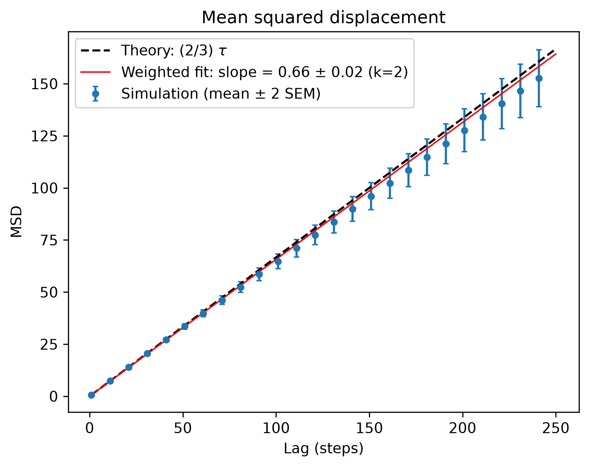

# MSD of a 2D random walk

Python script that simulates 2D random walks and computes the mean squared displacement (MSD).

- 100 trajectories, 1000 points each; steps in x and y drawn uniformly from [-1, 1]
- MSD averaged over time origins and trajectories, with error bars (k = 2 × SEM)
- Weighted linear fit; error on the slope from the spread of per-trajectory fits
- Diffusion coefficient D = slope / 4 (theory: D = 1/6)

## Usage

```
python random_walk_msd.py
```

Figures are saved in `figures/`.


